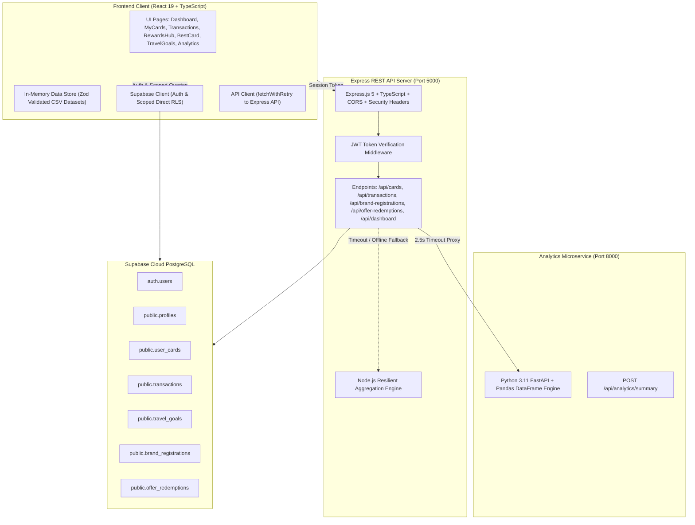

# CardIO — Run Your Cards Smarter

[](LICENSE)
[](https://www.typescriptlang.org/)
[](https://react.dev/)
[](https://tailwindcss.com/)
[](https://expressjs.com/)
[](https://fastapi.tiangolo.com/)
[](https://supabase.com/)
[]()
[]()

> **CardIO** is a modern, full-stack personal finance and intelligent credit card optimization platform tailored for the Indian credit card and loyalty ecosystem. It maximizes savings, unifies merchant offers, tracks registration campaigns, monitors confirmed vs. pending cashback, and plans air-mile travel redemptions.

---

## 1. Project Overview & Problem Statement

### The Problem
Indian credit card holders face severe reward fragmentation:
1. **Opaque & Complex Offer Terms**: Bank discounts (e.g., "10% off up to ₹1,500 on min. ₹5,000 spend") vary across card tiers, networks, and merchant categories. Users rarely know which card in their wallet yields the highest net benefit.
2. **Mandatory Brand Registrations**: Accelerated reward multipliers (e.g., Amex 5X multiplier, Axis GrabDeals, HDFC SmartBuy) often require prior registration via dedicated portals using registered emails or phone numbers. Unregistered users miss out on thousands of rupees.
3. **Tracking & Reconciliation Breakdown**: Instant discounts apply immediately at checkout, but cashbacks often have a 90-day settlement window. Users lack a centralized mechanism to track whether promised cashback actually hit their statements.
4. **Sub-optimal Point Valuations**: Reward points are not created equal; 1 point on an entry-level card may be worth ₹0.20, whereas 1 point on a super-premium card (e.g., HDFC Infinia Metal) can be worth ₹1.00 when redeemed against flights.

### The CardIO Solution
CardIO acts as an automated, intelligent co-pilot:
- Evaluates real-time merchant transactions against bank benefit datasets and caps.
- Tracks platform registrations and alerts users before promotional windows expire.
- Manages the full offer redemption lifecycle with strict financial segregation of confirmed savings and pending cashback.
- Computes award flight redemption costs and reverse-calculates required spends using actual airline loyalty charts.
- Provides executive-level financial analytics powered by Python FastAPI + Pandas with automated Node.js fallback.

---

## 2. Key Features & User Workflows


### 1. Credit Card Portfolio Management (`My Cards`)
- Curated catalogue of **280+ Indian credit cards** across major issuers (HDFC, SBI, ICICI, Axis, Amex, Standard Chartered, Kotak, YES Bank).
- Interactive 3D tilt cards rendered using Framer Motion with realistic physical glare, card networks, and custom credit limits.
- Portfolio metrics: billing cycle tracking, payment due date monitoring, and card-specific point valuations.

### 2. Intelligent Offer Eligibility & Recommendation Engine
- Card-variant specific matching: Differentiates between entry, mid, and super-premium cards from the same issuer.
- Strict constraint validation: Checks minimum spend thresholds, percentage benefits, maximum discount caps (`isCapped`), network restrictions (Visa, Mastercard, RuPay), and offer expiration dates.
- Registration awareness: Verifies whether the user is registered on the relevant brand portal before recommending an accelerated offer.

### 3. Brand Registration Tracker
- Records merchant platform campaign registrations (e.g., Amazon Pay, Swiggy One, MakeMyTrip Black, Flipkart VIP).
- Zero PII leakage: Deterministic client and server-side masking for registered email addresses (`j***e@domain.com`) and phone numbers (`+91 98*** **210`).
- Automated reminder engine: Flags registrations nearing their validity expiry date.

### 4. Transaction Management & Matching
- Real-time transaction recording with live card recommendations based on selected merchant and spend category.
- Automatic redemption linking: Links transactions to matching offers and sets initial state to `APPLIED`.
- CSV Statement Export for offline expense tracking and financial audits.

### 5. Offer Redemption & Savings Lifecycle
- Enforces an immutable 7-stage state transition machine: `AVAILABLE` $\rightarrow$ `SAVED` $\rightarrow$ `APPLIED` $\rightarrow$ `REDEEMED` or `PENDING_CASHBACK` $\rightarrow$ `REDEEMED`.
- Separation of concerns: Confirmed discounts and received cashbacks are segregated from pending cashback until receipt verification.
- Point valuation into INR: Translates loyalty points into fiat currency (₹) using verified issuer redemption rates.

### 6. Rewards Hub
- Explore active promotional offers across Travel, Dining, Movies, Shopping, and Groceries.
- Filter offers by issuer, minimum spend, validity date, and card tier.
- Interactive coupon confirmation modal allowing users to confirm receipt and record actual received savings.

### 7. Travel Goals & Reverse Spend Planning
- Award flight charts covering domestic and international airline loyalty programs (Air India Maharaja Club, Singapore Airlines KrisFlyer, British Airways Executive Club, etc.).
- IATA airport code lookup with route-based point estimation across Economy, Premium Economy, Business, and First class.
- Reverse spend calculator: Computes the exact spending required across user cards to earn target points for a flight booking.

### 8. Personal Finance Dashboard & Analytics
- Executive KPI summary: Month-over-Month (MoM) spend change, confirmed savings, pending cashback, total earned points.
- Interactive Recharts visualizations: Spend by Category (Pie Chart), Monthly Spend Trajectory (Bar Chart), and Top Merchants by Confirmed Savings.
- Multi-tier analytics architecture: Python FastAPI + Pandas microservice with sub-second Node.js in-memory failover.

---

## 3. Architecture & Technology Stack



| Layer | Technology | Key Libraries / Roles |
|---|---|---|
| **Frontend** | React 19, TypeScript, Vite 8 | Tailwind CSS v4, Framer Motion (3D Cards), Recharts, Lucide Icons, Zod |
| **Backend** | Node.js, Express.js 5, TypeScript | `@supabase/supabase-js`, `cors`, `dotenv`, `tsx` |
| **Analytics** | Python 3.11, FastAPI | `pandas`, `pydantic`, `uvicorn` |
| **Database** | PostgreSQL (Supabase) | Row Level Security (RLS), PL/pgSQL Triggers, Unique Indexes, Constraints |
| **Static Data** | Public CSV Datasets | 280 credit cards, 446 conversion ratios, 73 award routes, 96 airports |
| **Testing** | Vitest 5.0 | 7 test suites, 88 test assertions, Mock/Unit/Regression coverage |

---

## 4. Repository Structure

```
CARDIO-main/
├── analytics/                      # Python FastAPI analytics service
│   ├── main.py                     # FastAPI routes and Pandas aggregation engine
│   ├── requirements.txt            # Python dependencies (fastapi, uvicorn, pandas, pydantic)
│   └── venv/                       # Python virtual environment (ignored in git)
├── client/                         # React 19 frontend application
│   ├── public/data/                # Static Indian credit card and loyalty CSV datasets
│   │   ├── credit_cards.csv        # 280 credit card variants with fee and reward rates
│   │   ├── card_program_ratios.csv # 446 airline/hotel point transfer ratios
│   │   ├── award_chart.csv         # 73 award flight routes with required points
│   │   ├── airports.csv            # 96 Indian & international airport IATA codes
│   │   └── loyalty_programs.csv    # Airline and hotel frequent flyer metadata
│   ├── src/
│   │   ├── components/             # Reusable UI widgets (AnimatedCard, Navigation, etc.)
│   │   ├── lib/
│   │   │   ├── engine/             # Core business logic algorithms
│   │   │   │   ├── offerEngine.ts         # Variant matching, caps & eligibility engine
│   │   │   │   ├── savingsCalculator.ts   # 7-stage state machine & accounting engine
│   │   │   │   ├── dashboardAnalytics.ts  # KPI aggregations & MoM spend trends
│   │   │   │   ├── brandRegistration.ts   # Masking & reminder algorithms
│   │   │   │   └── *.test.ts              # Vitest automated unit and integration tests
│   │   │   ├── utils/              # PII masking (maskIdentifier) and helper routines
│   │   │   └── api.ts              # Authenticated API client with token auto-refresh
│   │   ├── pages/                  # Top-level view routes (Dashboard, MyCards, RewardsHub, etc.)
│   │   ├── App.tsx                 # React router and global application layout
│   │   └── main.tsx                # Client entrypoint
│   ├── .env.example                # Frontend environment template
│   └── package.json
├── database/                       # Legacy SQL reference schemas
│   ├── schema.sql                  # Initial schema reference
│   └── seed.sql                    # Initial seed data
├── docs/                           # Comprehensive technical & audit documentation
│   ├── architecture.md             # System architecture & component interaction flows
│   ├── database-schema.md          # PostgreSQL tables, ERD, RLS policies & constraints
│   ├── api-documentation.md        # Complete REST API specifications & response schemas
│   ├── testing.md                  # Vitest, Python & manual browser test suites
│   └── FINAL_RELEASE_REPORT.md     # Production release readiness audit & verification report
├── server/                         # Express.js backend REST API
│   ├── index.ts                    # Server entrypoint, middleware, routes, IDOR defenses
│   ├── .env.example                # Backend environment template
│   └── package.json
├── supabase/migrations/            # Production Supabase SQL migrations (applied in order)
│   ├── 20261007_init.sql           # Base tables (profiles, user_cards, transactions, travel_goals)
│   ├── 20261031_brand_registrations_v2.sql # Brand registration tracker schema & RLS
│   └── 20261031_offer_redemptions.sql      # Offer redemption lifecycle schema & check constraints
├── .gitignore                      # Git ignore rules for secrets, builds & virtualenvs
├── README.md                       # Project documentation (this file)
└── start_all.ps1                   # One-click Windows PowerShell multi-service runner
```

---

## 5. Prerequisites & Local Setup

### System Prerequisites
- **Node.js**: `v20.x` or `v22.x` LTS ([Download Node.js](https://nodejs.org/))
- **npm**: `v10.x` or higher
- **Python**: `v3.11` or higher ([Download Python](https://www.python.org/))
- **Supabase Account**: Free hosted project at [supabase.com](https://supabase.com) (or local Supabase CLI)

### Step 1: Clone the Repository
```bash
git clone https://github.com/your-username/cardio.git
cd cardio
```

### Step 2: Database Setup & Migrations (Supabase)
1. Log in to your [Supabase Dashboard](https://supabase.com/dashboard) and create a new project.
2. Navigate to the **SQL Editor** tab.
3. Apply the migrations in strict sequential order:
   - Run [`supabase/migrations/20261007_init.sql`](supabase/migrations/20261007_init.sql)
   - Run [`supabase/migrations/20261031_brand_registrations_v2.sql`](supabase/migrations/20261031_brand_registrations_v2.sql)
   - Run [`supabase/migrations/20261031_offer_redemptions.sql`](supabase/migrations/20261031_offer_redemptions.sql)
4. Retrieve your **Project URL**, **Anon Key**, and **Service Role Key** from **Project Settings $\rightarrow$ API**.

### Step 3: Environment Variable Configuration
Copy the provided `.env.example` templates and fill in your Supabase credentials:

#### Backend Configuration (`server/.env`):
```bash
cp server/.env.example server/.env
```
Edit `server/.env`:
```env
PORT=5000
SUPABASE_URL=https://your-project-id.supabase.co
SUPABASE_ANON_KEY=your_supabase_anon_key_here
SUPABASE_SERVICE_ROLE_KEY=your_supabase_service_role_key_here
CLIENT_ORIGIN=http://localhost:5173
```

#### Frontend Configuration (`client/.env`):
```bash
cp client/.env.example client/.env
```
Edit `client/.env`:
```env
VITE_SUPABASE_URL=https://your-project-id.supabase.co
VITE_SUPABASE_ANON_KEY=your_supabase_anon_key_here
```

### Step 4: Install Dependencies

#### Install Client Dependencies:
```bash
cd client
npm install
cd ..
```

#### Install Server Dependencies:
```bash
cd server
npm install
cd ..
```

#### Setup Python Virtual Environment & Dependencies:
```bash
cd analytics
python -m venv venv

# On Windows (PowerShell):
.\venv\Scripts\Activate.ps1

# On macOS/Linux:
source venv/bin/activate

pip install -r requirements.txt
cd ..
```

---

## 6. Running the Application

### Option A: One-Click Startup (Windows PowerShell)
You can launch all three services simultaneously in individual terminal windows using the included script:
```powershell
.\start_all.ps1
```

### Option B: Manual Multi-Terminal Startup

#### Terminal 1 — Express REST API Backend
```bash
cd server
npm run dev
# Server runs at http://localhost:5000
```

#### Terminal 2 — Python FastAPI Analytics Service
```bash
cd analytics
# Activate virtual environment
.\venv\Scripts\activate   # Windows
# source venv/bin/activate # macOS/Linux

python main.py
# Analytics microservice runs at http://localhost:8000
```

#### Terminal 3 — React Frontend Client
```bash
cd client
npm run dev
# Frontend runs at http://localhost:5173
```

Open `http://localhost:5173` in your browser. Register a new user account or log in to begin exploring your credit card portfolio!

---

## 7. Testing & Build Commands

### 1. Run Automated Unit & Regression Tests (Client)
```bash
cd client
npm run test
```
*Executes all 88 Vitest tests across 7 test suites, verifying offer calculations, state machine transitions, IDOR defenses, and financial aggregations.*

### 2. Verify Python Analytics Service
```bash
cd analytics
.\venv\Scripts\python.exe -c "
import sys; sys.path.insert(0, '.')
from main import get_analytics_summary, AnalyticsRequest, Transaction
res = get_analytics_summary(AnalyticsRequest(transactions=[Transaction(amount=5000, category='Dining')]))
assert res['total_spend'] == 5000.0
print('Python analytics verified!')
"
```

### 3. Compile Production Builds
```bash
# Compile Client (Vite + TypeScript)
cd client
npm run build
# Generates optimized static assets in client/dist/

# Compile Server (TypeScript)
cd ../server
npm run build
# Generates compiled CommonJS JavaScript in server/dist/
```

### 4. Dependency Vulnerability Audits
```bash
npm --prefix client audit
npm --prefix server audit
# Both return: "found 0 vulnerabilities"
```

---

## 8. Known Limitations & Future Scope

### Known Limitations
1. **Manual Transaction Entry**: Transactions are currently inputted manually or uploaded via CSV statements. Direct account aggregator integration (e.g., Setu / OneMoney AA) is not yet connected.
2. **Local Python Execution**: The Python FastAPI microservice is designed as an internal microservice on `localhost:8000`. In single-container production deployments, Node.js fallback functions as the primary aggregation engine unless Python is containerized.
3. **Static Merchant Benefit CSVs**: Merchant benefit datasets are periodically curated CSV files rather than live web scrapers to ensure zero downtime and deterministic calculation performance.

### Future Scope
- **Bank SMS & Email Parser**: Optional client-side regex parsing for Indian bank transaction SMS messages (e.g., HDFC, ICICI, SBI alerts) to auto-populate transactions.
- **Account Aggregator (AA) Integration**: RBI-approved Account Aggregator consent flows for automated statement syncing.
- **OCR Receipt Scanning**: Machine-learning receipt analysis to automatically verify instant coupon discounts on invoice uploads.
- **Native Mobile Application**: React Native / Expo build sharing the existing `@cardio/engine` business logic.

---

## 9. Academic & Project Attribution

- **Project:** B.Tech Major Project / Portfolio Showcase
- **Developed by:** CardIO Engineering Team
- **Academic Year:** 2026
- **Architecture Documentation:** See [`docs/architecture.md`](docs/architecture.md)
- **Database Schema & RLS:** See [`docs/database-schema.md`](docs/database-schema.md)
- **REST API Reference:** See [`docs/api-documentation.md`](docs/api-documentation.md)
- **Comprehensive Audit Report:** See [`docs/FINAL_RELEASE_REPORT.md`](docs/FINAL_RELEASE_REPORT.md)
