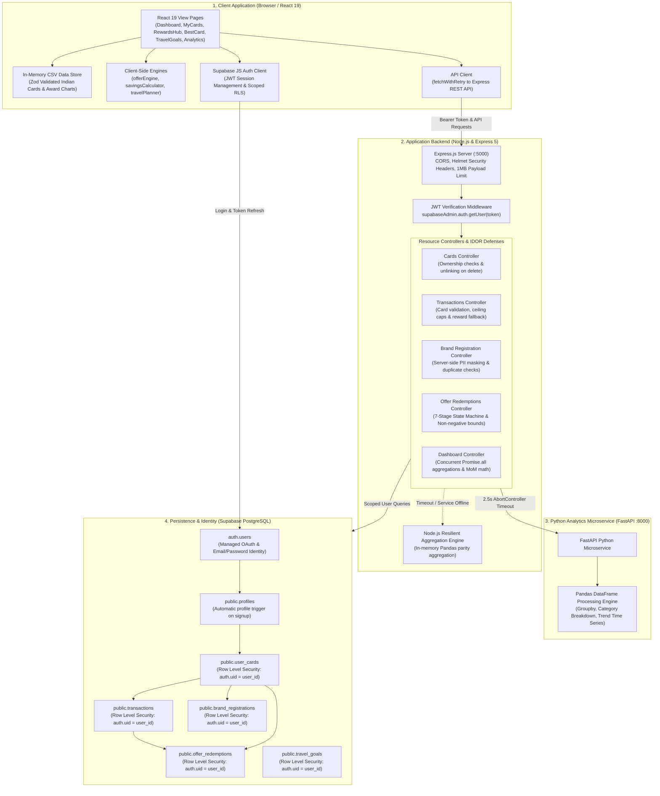
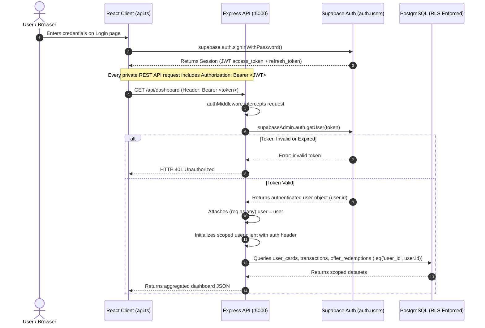
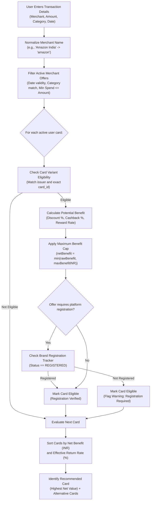
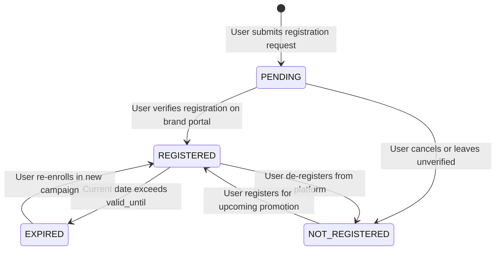
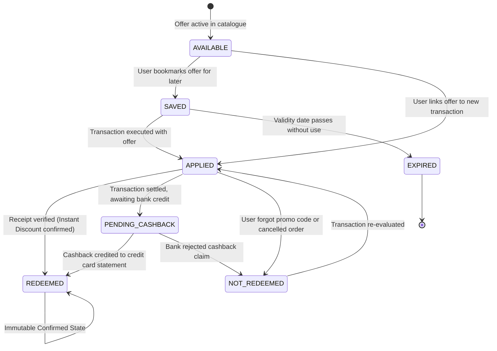
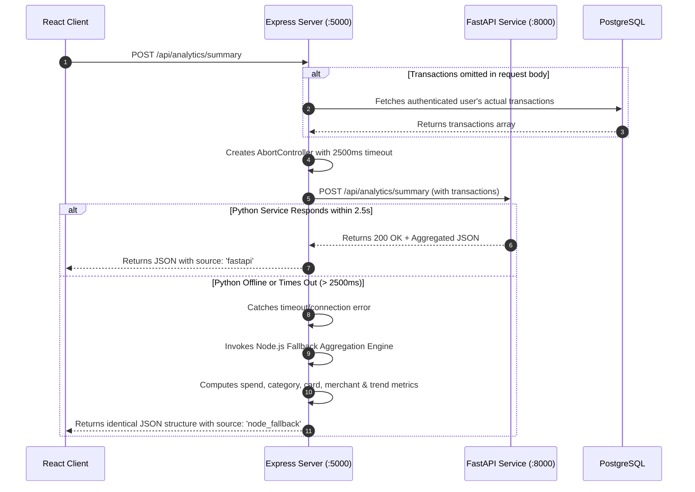

# CardIO System Architecture Documentation

**System:** CardIO — Intelligent Credit Card Optimization Platform  
**Document:** System Architecture & Component Interaction Specification  
**Status:** Approved for Release  
**Version:** 2.0.0  

---

## 1. High-Level Architecture Overview

CardIO is engineered as a multi-tier, hybrid application designed for high-precision financial calculations, strict user isolation, and resilient failover. It decouples static credit card knowledge (catalogue, conversion ratios, airline award charts) from user financial data (cards, transactions, registrations, redemptions).

---

## 2. Component Interactions & Communication Patterns

### 2.1 Hybrid Data Model
1. **Static Financial Datasets**:
   - Reside in `client/public/data/` (`credit_cards.csv`, `card_program_ratios.csv`, `award_chart.csv`, `airports.csv`).
   - Validated on client startup using Zod schemas in `dataStore.ts`.
   - Indexed into high-speed in-memory Maps (`cardById`, `ratiosByCard`, `awardsByRoute`).
   - Advantage: Zero database round-trips for card catalogue searches, instant 3D card rendering, and deterministic offline offer calculations.

2. **Dynamic Transactional & User Data**:
   - Persisted in Supabase PostgreSQL tables.
   - Protected by Row Level Security (RLS) policies ensuring users can only read, insert, update, or delete their own rows.
   - Accessed via two distinct paths:
     - Direct Supabase Client: Used for user authentication sessions and scoped direct queries.
     - Express REST API: Used for complex cross-entity operations, IDOR verification, server-side PII masking, lifecycle state machine enforcement, and analytics proxying.

---

## 3. Authentication & Authorization Flow

### Authorization Rules & IDOR Defense
- **Token Source of Truth**: User ID is never accepted from the request body or URL parameters. It is extracted strictly from `(req as any).user.id` verified by Supabase Auth.
- **Resource Ownership Verification**: When mutating child entities that reference existing resources (`user_card_id`, `transaction_id`), the backend performs defensive database checks (`verifyUserCardOwnership`, `verifyTransactionOwnership`) to prevent Insecure Direct Object References (IDOR).
- **Graceful Token Refresh**: The frontend `api.ts` transparently catches 401 errors, invokes `supabase.auth.refreshSession()`, and replays the original request with the fresh token.

---

## 4. Intelligent Offer Eligibility & Recommendation Workflow

The offer engine (`client/src/lib/engine/offerEngine.ts`) implements variant-specific matching, spend threshold validation, discount capping, and registration verification.

### Offer Valuation Rules
1. **Instant Discounts vs. Cashback**: Instant discount is applied directly against the invoice amount; cashback is recorded as an expected post-settlement benefit.
2. **Cap Enforcement**: If a 10% discount on a ₹20,000 transaction yields ₹2,000, but the offer cap is ₹1,500:
   $$\text{netBenefitINR} = \min(2000, 1500) = 1500$$
   $$\text{isCapped} = \text{true}$$
3. **Reward Points Conversion**: Card reward points are converted to rupee equivalents using card-specific point values:
   $$\text{Reward Value (INR)} = \frac{\text{Points Earned} \times \text{Point Value (Paise)}}{100}$$

---

## 5. Brand Registration & Offer Redemption Lifecycles

### 5.1 Brand Registration Lifecycle
The Brand Registration Tracker (`client/src/lib/engine/brandRegistration.ts`) tracks platform promotional enrollments with strict PII masking.

- **Masking at Rest**: Raw identifiers (emails and phone numbers) are masked before persisting to the database.
- **Expiry Monitoring**: Registrations expiring within 7 days are automatically surfaced as alert badges on the My Cards page.

---

### 5.2 Offer Redemption Lifecycle State Machine
Offer redemptions follow a deterministic, non-regressive state machine defined in `client/src/lib/engine/savingsCalculator.ts`.

### Financial Segregation Principle
- **Confirmed Savings**:
  $$\text{Confirmed Savings} = \sum_{\text{REDEEMED}} (\text{Confirmed Discount} + \text{Confirmed Cashback} + \text{Confirmed Points Value})$$
- **Pending Cashback**:
  $$\text{Pending Cashback} = \sum_{\text{PENDING\_CASHBACK}} \text{Estimated Cashback}$$
- Under no circumstances is pending cashback credited to confirmed savings until settlement receipt confirmation.

---

## 6. Analytics Microservice & Failover Architecture

CardIO utilizes a dual-engine architecture for expense and savings analytics:
1. **Primary Engine**: Standalone Python 3.11 service utilizing **FastAPI + Pandas** running on `localhost:8000`. It provides high-performance group-by operations, category breakdowns, and time-series aggregations.
2. **Resilient Failover Engine**: Embedded **Node.js aggregation engine** inside the Express backend.

### Zero-State Resilience
Both Python and Node.js engines safely process empty transaction lists (`[]`), returning zeroed totals and empty maps rather than throwing `DivisionByZero` or `NaN` errors.
