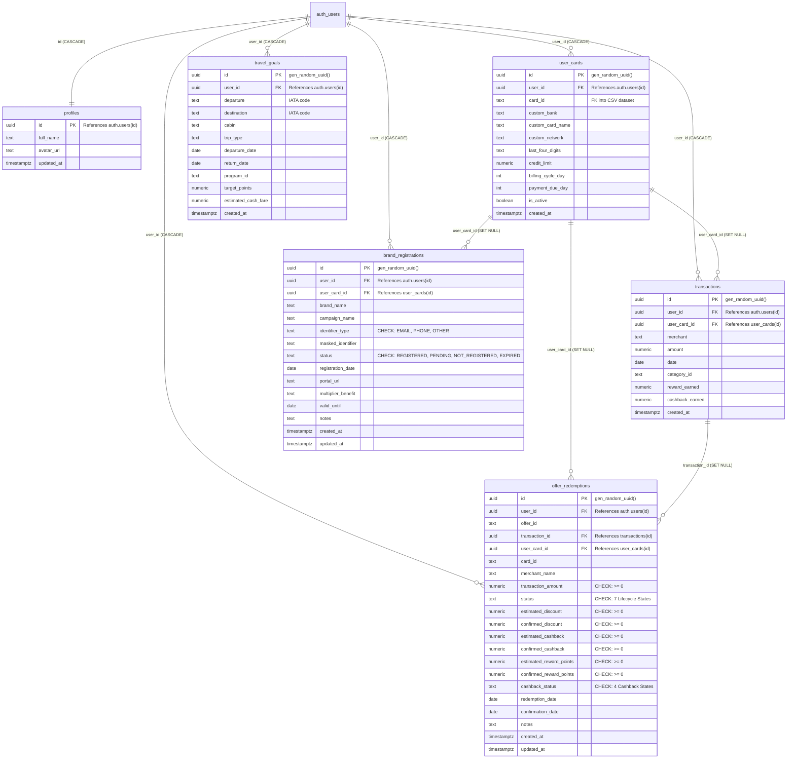

# CardIO Database Schema & RLS Specification

**System:** CardIO — Intelligent Credit Card Optimization Platform  
**Database:** PostgreSQL 15+ (Hosted on Supabase)  
**Security:** Full Row Level Security (RLS) on all user-facing tables  
**Status:** Approved for Release  
**Version:** 2.0.0  

---

## 1. Entity-Relationship Diagram (ERD)



---

## 2. Table Specifications

### 2.1 `public.profiles`
Stores user profile information. Automatically populated via database trigger upon registration in `auth.users`.
- **Primary Key**: `id` (`UUID`) references `auth.users(id)` `ON DELETE CASCADE`.
- **Columns**:
  - `full_name` (`TEXT`): User's display name.
  - `avatar_url` (`TEXT`): Optional profile avatar link.
  - `updated_at` (`TIMESTAMPTZ`): Last profile modification timestamp.

### 2.2 `public.user_cards`
Stores cards currently held in a user's wallet.
- **Primary Key**: `id` (`UUID`, default: `gen_random_uuid()`).
- **Foreign Keys**:
  - `user_id` (`UUID`) references `auth.users(id)` `ON DELETE CASCADE`.
- **Columns**:
  - `card_id` (`TEXT`): Identifier linking to static catalogue in `credit_cards.csv` (e.g., `hdfc-infinia`).
  - `custom_bank` (`TEXT`): User-specified bank name (for custom cards).
  - `custom_card_name` (`TEXT`): User-specified card name (for custom cards).
  - `custom_network` (`TEXT`): Payment network (`VISA`, `MASTERCARD`, `RUPAY`, `AMEX`).
  - `last_four_digits` (`TEXT`): Last four digits for physical card identification.
  - `credit_limit` (`NUMERIC`): Total credit limit allocated to the card.
  - `billing_cycle_day` (`INT`): Day of the month (1–31) when statement is generated.
  - `payment_due_day` (`INT`): Day of the month (1–31) when payment is due.
  - `is_active` (`BOOLEAN`, default: `TRUE`): Flag indicating if the card is active in wallet.
  - `created_at` (`TIMESTAMPTZ`, default: `NOW()`).

### 2.3 `public.transactions`
Records user spending history.
- **Primary Key**: `id` (`UUID`, default: `gen_random_uuid()`).
- **Foreign Keys**:
  - `user_id` (`UUID`) references `auth.users(id)` `ON DELETE CASCADE`.
  - `user_card_id` (`UUID`) references `public.user_cards(id)` `ON DELETE SET NULL`.
- **Columns**:
  - `merchant` (`TEXT`, NOT NULL): Name of merchant (e.g., `Amazon`, `Swiggy`, `Air India`).
  - `amount` (`NUMERIC`, NOT NULL): Transaction amount in INR.
  - `date` (`DATE`, default: `CURRENT_DATE`): Transaction execution date.
  - `category_id` (`TEXT`): Expense category (`Dining`, `Shopping`, `Travel`, `Grocery`, etc.).
  - `reward_earned` (`NUMERIC`, default: `0`): Base reward points earned.
  - `cashback_earned` (`NUMERIC`, default: `0`): Instant cashback credited.
  - `created_at` (`TIMESTAMPTZ`, default: `NOW()`).

### 2.4 `public.travel_goals`
Tracks target award flight redemption plans.
- **Primary Key**: `id` (`UUID`, default: `gen_random_uuid()`).
- **Foreign Keys**:
  - `user_id` (`UUID`) references `auth.users(id)` `ON DELETE CASCADE`.
- **Columns**:
  - `departure` (`TEXT`, NOT NULL): Origin airport 3-letter IATA code (e.g., `DEL`).
  - `destination` (`TEXT`, NOT NULL): Destination airport 3-letter IATA code (e.g., `SIN`).
  - `cabin` (`TEXT`, default: `'ECONOMY'`): Cabin class (`ECONOMY`, `PREMIUM_ECONOMY`, `BUSINESS`, `FIRST`).
  - `trip_type` (`TEXT`, default: `'ONE_WAY'`): Flight itinerary type (`ONE_WAY`, `RETURN`).
  - `departure_date` (`DATE`): Planned travel departure date.
  - `return_date` (`DATE`): Planned return date for round trips.
  - `program_id` (`TEXT`): Airline loyalty program ID (e.g., `AIR_INDIA_MAHARAJA`).
  - `target_points` (`NUMERIC`, default: `0`): Required frequent flyer miles/points.
  - `estimated_cash_fare` (`NUMERIC`): Equivalent commercial cash ticket price.
  - `created_at` (`TIMESTAMPTZ`, default: `NOW()`).

### 2.5 `public.brand_registrations`
Tracks brand platform campaign registrations with secure masking.
- **Primary Key**: `id` (`UUID`, default: `gen_random_uuid()`).
- **Foreign Keys**:
  - `user_id` (`UUID`) references `auth.users(id)` `ON DELETE CASCADE`.
  - `user_card_id` (`UUID`) references `public.user_cards(id)` `ON DELETE SET NULL`.
- **Columns**:
  - `brand_name` (`TEXT`, NOT NULL): Platform or merchant name.
  - `campaign_name` (`TEXT`): Optional campaign promotion title.
  - `identifier_type` (`TEXT`, default: `'EMAIL'`): Identifier type (`EMAIL`, `PHONE`, `OTHER`).
  - `masked_identifier` (`TEXT`): Masked identifier at rest (`j***e@domain.com`).
  - `status` (`TEXT`, default: `'PENDING'`): Enrollment status (`REGISTERED`, `PENDING`, `NOT_REGISTERED`, `EXPIRED`).
  - `registration_date` (`DATE`, default: `CURRENT_DATE`): Date user registered.
  - `portal_url` (`TEXT`): Link to the external registration portal.
  - `multiplier_benefit` (`TEXT`): Promotional multiplier benefit (e.g., `5X Reward Points`).
  - `valid_until` (`DATE`): Campaign expiration date.
  - `notes` (`TEXT`): Optional user notes (max 500 characters).
  - `created_at` (`TIMESTAMPTZ`, default: `NOW()`).
  - `updated_at` (`TIMESTAMPTZ`, default: `NOW()`).

### 2.6 `public.offer_redemptions`
Tracks the complete lifecycle of promotional offers and confirmed financial savings.
- **Primary Key**: `id` (`UUID`, default: `gen_random_uuid()`).
- **Foreign Keys**:
  - `user_id` (`UUID`) references `auth.users(id)` `ON DELETE CASCADE`.
  - `transaction_id` (`UUID`) references `public.transactions(id)` `ON DELETE SET NULL`.
  - `user_card_id` (`UUID`) references `public.user_cards(id)` `ON DELETE SET NULL`.
- **Columns**:
  - `offer_id` (`TEXT`, NOT NULL): Static identifier matching promotional dataset.
  - `card_id` (`TEXT`): Catalogue card identifier for point valuation.
  - `merchant_name` (`TEXT`, NOT NULL): Merchant offering the benefit.
  - `transaction_amount` (`NUMERIC`, default: `0`): Associated spend amount.
  - `status` (`TEXT`, default: `'SAVED'`): Offer lifecycle state (`AVAILABLE`, `SAVED`, `APPLIED`, `REDEEMED`, `PENDING_CASHBACK`, `EXPIRED`, `NOT_REDEEMED`).
  - `estimated_discount` (`NUMERIC`, default: `0`): Estimated instant discount benefit in INR.
  - `confirmed_discount` (`NUMERIC`, default: `0`): Confirmed invoice discount in INR.
  - `estimated_cashback` (`NUMERIC`, default: `0`): Estimated pending cashback in INR.
  - `confirmed_cashback` (`NUMERIC`, default: `0`): Confirmed statement credit in INR.
  - `estimated_reward_points` (`NUMERIC`, default: `0`): Estimated accelerated reward points.
  - `confirmed_reward_points` (`NUMERIC`, default: `0`): Confirmed reward points earned.
  - `cashback_status` (`TEXT`, default: `'NOT_APPLICABLE'`): Status (`NOT_APPLICABLE`, `PENDING`, `RECEIVED`, `FAILED`).
  - `redemption_date` (`DATE`, default: `CURRENT_DATE`): Date redemption was initiated.
  - `confirmation_date` (`DATE`): Date benefit receipt was confirmed.
  - `notes` (`TEXT`): User notes or coupon code used.
  - `created_at` (`TIMESTAMPTZ`, default: `NOW()`).
  - `updated_at` (`TIMESTAMPTZ`, default: `NOW()`).

---

## 3. Database Constraints & Unique Indexes

### 3.1 Check Constraints
1. **Brand Registration Status**:
   ```sql
   CHECK (status IN ('REGISTERED', 'PENDING', 'NOT_REGISTERED', 'EXPIRED'))
   ```
2. **Brand Identifier Type**:
   ```sql
   CHECK (identifier_type IN ('EMAIL', 'PHONE', 'OTHER'))
   ```
3. **Offer Redemption Lifecycle Status**:
   ```sql
   CHECK (status IN ('AVAILABLE', 'SAVED', 'APPLIED', 'REDEEMED', 'PENDING_CASHBACK', 'EXPIRED', 'NOT_REDEEMED'))
   ```
4. **Offer Redemption Cashback Status**:
   ```sql
   CHECK (cashback_status IN ('NOT_APPLICABLE', 'PENDING', 'RECEIVED', 'FAILED'))
   ```
5. **Non-Negative Financial Bounds**:
   ```sql
   CHECK (
     transaction_amount >= 0 AND
     estimated_discount >= 0 AND
     confirmed_discount >= 0 AND
     estimated_cashback >= 0 AND
     confirmed_cashback >= 0 AND
     estimated_reward_points >= 0 AND
     confirmed_reward_points >= 0
   )
   ```

### 3.2 Unique Indexes (Duplicate Prevention)
1. **User Card Duplicate Prevention**:
   ```sql
   CREATE UNIQUE INDEX user_cards_user_card_unique
     ON public.user_cards(user_id, card_id)
     WHERE card_id IS NOT NULL;
   ```
2. **Brand Registration Duplicate Prevention (Case-Insensitive)**:
   ```sql
   CREATE UNIQUE INDEX idx_brand_registrations_user_brand_unique 
     ON public.brand_registrations(user_id, lower(trim(brand_name)));
   ```
3. **Redemption per Transaction Uniqueness**:
   ```sql
   CREATE UNIQUE INDEX idx_offer_redemptions_txn_offer_unique
     ON public.offer_redemptions(transaction_id, offer_id)
     WHERE transaction_id IS NOT NULL;
   ```
4. **Saved Offer Uniqueness per User**:
   ```sql
   CREATE UNIQUE INDEX idx_offer_redemptions_user_offer_saved_unique
     ON public.offer_redemptions(user_id, offer_id)
     WHERE transaction_id IS NULL AND status = 'SAVED';
   ```

---

## 4. Row Level Security (RLS) Policies

Row Level Security is enabled on **100% of tables**. All operations are bound directly to `auth.uid() = user_id`.

| Table | Operation | Policy Name | Enforcement Clause |
|---|---|---|---|
| `public.profiles` | SELECT | Users can view own profile | `USING (auth.uid() = id)` |
| `public.profiles` | INSERT | Users can insert own profile | `WITH CHECK (auth.uid() = id)` |
| `public.profiles` | UPDATE | Users can update own profile | `USING (auth.uid() = id)` |
| `public.user_cards` | SELECT | Users can view own cards | `USING (auth.uid() = user_id)` |
| `public.user_cards` | INSERT | Users can insert own cards | `WITH CHECK (auth.uid() = user_id)` |
| `public.user_cards` | UPDATE | Users can update own cards | `USING (auth.uid() = user_id)` |
| `public.user_cards` | DELETE | Users can delete own cards | `USING (auth.uid() = user_id)` |
| `public.transactions` | SELECT | Users can view own transactions | `USING (auth.uid() = user_id)` |
| `public.transactions` | INSERT | Users can insert own transactions | `WITH CHECK (auth.uid() = user_id)` |
| `public.transactions` | UPDATE | Users can update own transactions | `USING (auth.uid() = user_id)` |
| `public.transactions` | DELETE | Users can delete own transactions | `USING (auth.uid() = user_id)` |
| `public.travel_goals` | SELECT | Users can view own travel goals | `USING (auth.uid() = user_id)` |
| `public.travel_goals` | INSERT | Users can insert own travel goals | `WITH CHECK (auth.uid() = user_id)` |
| `public.travel_goals` | UPDATE | Users can update own travel goals | `USING (auth.uid() = user_id)` |
| `public.travel_goals` | DELETE | Users can delete own travel goals | `USING (auth.uid() = user_id)` |
| `public.brand_registrations` | SELECT | Users can view own registrations | `USING (auth.uid() = user_id)` |
| `public.brand_registrations` | INSERT | Users can insert own registrations | `WITH CHECK (auth.uid() = user_id)` |
| `public.brand_registrations` | UPDATE | Users can update own registrations | `USING (auth.uid() = user_id)` |
| `public.brand_registrations` | DELETE | Users can delete own registrations | `USING (auth.uid() = user_id)` |
| `public.offer_redemptions` | SELECT | Users can view own redemptions | `USING (auth.uid() = user_id)` |
| `public.offer_redemptions` | INSERT | Users can insert own redemptions | `WITH CHECK (auth.uid() = user_id)` |
| `public.offer_redemptions` | UPDATE | Users can update own redemptions | `USING (auth.uid() = user_id)` |
| `public.offer_redemptions` | DELETE | Users can delete own redemptions | `USING (auth.uid() = user_id)` |

---

## 5. Deletion & Unlinking Cascades

To ensure financial historical integrity and prevent orphan records or accidental data loss:
- When a **User Account** is deleted (`auth.users`), all associated rows across all 6 tables are automatically removed via `ON DELETE CASCADE`.
- When a **User Card** is removed (`user_cards`), foreign keys in `transactions`, `brand_registrations`, and `offer_redemptions` are automatically set to `NULL` via `ON DELETE SET NULL`. Spend history and confirmed savings are strictly preserved.
- When a **Transaction** is deleted (`transactions`), any linked `offer_redemptions` have their `transaction_id` set to `NULL`, their status updated to `NOT_REDEEMED`, and a note attached explaining the transaction deletion.
